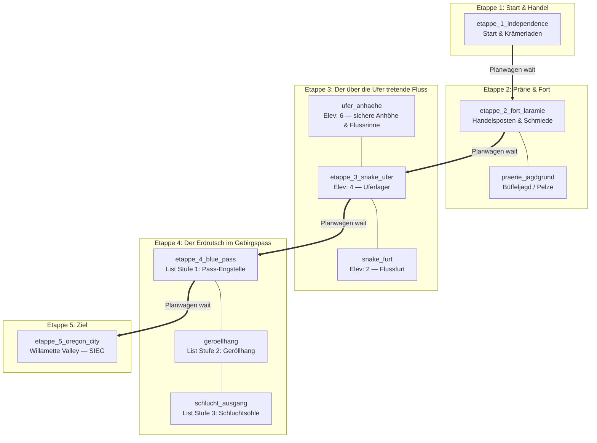

# Plan: Oregon Trail — „Der Treck nach Westen“

**Stand:** 2026-10-17 · **Status:** ✅ umgesetzt (`d81d4a9`, 2026-10-14) — `examples/genres/oregon_trail.yaml`,
E2E `oregon_trail` + `oregon_trail-dysentery-fail`, in `scripts/ci.sh` registriert.
Abweichung vom Entwurf: der Radbruch (O3) läuft über den Fallback — Flag `radbruch` +
`on: before wait`-Veto/`repair`-Regel —, weil der Fahrzeug-Zustand-Setter erst danach kam
(`OPEN-24`, `391dfa9`). Eine Umstellung auf `apply_vehicle_condition` ist möglich, aber nicht nötig.
**Herkunft:** `docs/spielideen.md` §1 (Reihenfolge-Platz #3, „nur Content“) ·
Umsetzungsplan: `~/workspace/plan-spielideen-umsetzung.md`
**Ziel-Datei:** `examples/genres/oregon_trail.yaml`

Benchmark-Abenteuer, das mehrere Module in einem kompakten Spiel zeigt und als
**erster großer Anwendungsfall der neuen Gefahrenlagen (`hazards:`, OPEN-23)**
dient: ein Fluss, der über die Ufer tritt (`footprint: by elevation`) und ein
Erdrutsch im Gebirgspass (`footprint: by list`).

---

## 1. Ziel

Ein Wagenzug zieht in Etappen nach Westen: Proviant kaufen, Flüsse durchqueren,
Krankheiten überstehen. Fast jeder kennt das Vorbild (Oregon Trail, 1971/MECC),
und das Spiel zeigt viele Module der Engine in einem stimmigen Rahmen:

| Modul | Einsatz im Spiel |
|---|---|
| **7j `hazards:` (OPEN-23)** | Fluss-Hochwasser (steigend/fallend, `elevation`) + Erdrutsch (Phasen, `list`, `remove_exit`/`set_exit`) |
| **Fahrzeuge (7h/0.5)** | Planwagen `type: auto` mit Automatikroute über 5 Etappen-Stopps, Innenraum, Fahrzeug-Zustand `radbruch` |
| **7d Survival/Wetter** | Proviant-Drain (Hungertod), Wetter `klar`/`dauerregen`/`schneesturm` |
| **7b Handel** | Handelsposten Independence & Fort Laramie (`buy`/`sell`, `dollars`, Lagerbestand) |
| **7c Encounters** | Prärie-Tabelle (Büffelherde, Klapperschlange, Achsenknarren) mit `cooldown` |
| **Conditions (Phase 2.1)** | `ruhr` (Dysenterie) als Tick-Condition, heilbar durch Medizin |
| **Dynamische Ausgänge** | `remove_exit` (verschütteter Pass) / `set_exit` (freigeräumt) |

**Kern-Eingriffe: keine.** Alles ist Content auf bestehender Engine-Fähigkeit —
das ist der Punkt des Benchmarks (Deckungstest für „nur Content“-These aus
`spielideen.md`).

---

## 2. Verifizierte Grundlagen (Code-Check, 2026-10-14)

| Frage | Befund | Beleg |
|---|---|---|
| Automatikroute per `wait`? | `type: auto` → `AutomaticRoute`; `wait` feuert `advanceVehicleRoute` → nächster Stopp (Wrap-around). Stopp-Reihenfolge = Map-Key-Order (`vehicleRoute` ist leer, wenn nicht autorisiert). | `src/Types/Vehicles.hs` 23–27, `src/Vehicles.hs` 63–79, 164–182 |
| Stopp-Reihenfolge steuern? | Über **alphabetische Raum-IDs** (`etappe_1_…` … `etappe_5_…`), da `vehicleRoute` aus YAML nicht befüllt wird. | `worldbuilder/src/Worldbuilder/Compile.hs` 4093 (`vehicleRoute = []`) |
| `OnEnter` feuert bei Stoppwechsel? | Ja — `moveVehicleToStop` setzt `currentRoom` auf den Außenraum; `commandEvents` leitet `OnLeave`/`OnEnter` aus dem Raumwechsel ab. Etappen-Trigger (`on: enter etappe_3_snake_ufer`) funktionieren also auch an Bord. | `src/Vehicles.hs` 117–125, `src/GameLoop.hs` 525–530 |
| Hazard `elevation`-Footprint? | Zone = `hazard.<id>.level >= schwelle(raum)`; Schwellen je Raum über `rooms: {raum: schwelle}`. | `docs/adventure-schema.md` 2662, `examples/modules/hazards.yaml` 16–20 |
| Hazard `list`-Footprint? | Feste Raumlisten je Stufe über `stages_rooms: {<level>: [räume]}`. | `docs/adventure-schema.md` 2663, `hazards.yaml` 63–66 |
| Reversibler Verlauf? | `target` + `rate`: Pegel läuft schrittweise Richtung Ziel — steigend wie fallend; `stages` feuern bei jedem Übergang `prev != n`. | `docs/plan-hazards.md` E1/E6 |
| Autor-Effekte | `hazard_target` (Ziel setzen), `hazard_jump` (hart setzen), `hazard_pause`/`hazard_resume` (Takt anhalten). | `docs/adventure-schema.md` 2673–2677 |
| Autor-Prädikate | `hazard_level: {hazard, op, value}`, `in_hazard: {hazard, room: here}`. | `docs/adventure-schema.md` 2679–2681 |
| `remove_exit`/`set_exit` zur Laufzeit? | Existiert (Rogue Phase 3), als Autoren-Effekt in Rules/Hooks nutzbar. | `docs/plan-hazards.md` §3 (Zeile „Ausgänge zur Laufzeit“) |
| Condition mit Tick/End? | `condition: {name, turns, tick, end, hidden}`; Prädikat `has_condition`; `clear_condition`. | `docs/adventure-schema.md` 870–919 |
| Fahrzeug-Zustand + Repair? | `conditions: {radbruch: …}` (Tick-Effekte), `repair <condition>` cleart. | `docs/adventure-schema.md` 1140–1146 |
| Handel als Daten? | `buy`/`sell` Custom-Verben, Transaktion über Item-`verb_map` (Conditional + CompareVar), Bestand in `initial_variables: shop.*`. | `examples/modules/trade.yaml` |
| Encounter mit Cooldown? | `encounter_tables:` → Trigger mit `RandomChoice`; `cooldown` zählt passende Ereignisse. | `docs/adventure-schema.md` 2470–2502 |
| Wetter + Drain? | `environment:` → `env.weather` (Int-Index) + `on: turn`-Drains mit `at_zero`. | `docs/adventure-schema.md` 2506–2533 |

**Folgerung:** Der komplette Entwurf ist mit bestehenden Primitiven ausdrückbar.
Kein Compiler-Pass, kein neuer Effekt, kein neues Prädikat.

---

## 3. Szenario & Handlung

**Oregon 1848.** Du führst einen Planwagen (*Prairie Schooner*) von Independence,
Missouri, über die Oregon Trail nach Westen ins Willamette Valley. Vorräte sind
knapp, der Fluss führt Hochwasser, und in den Blue Mountains hat der Regen den
Bergkamm aufgeweicht.

**Ziel:** Erreiche `etappe_5_oregon_city` mit lebendem Treck — oder stirb den
klassischen Oregon-Trail-Tod (Ruhr, Hunger, Flut, Erdrutsch).

**Dramaturgie der zwei Gefahrenlagen:**

1. **Etappe 3 — Snake River:** Beim Ankommen setzt der Wolkenbruch ein
   (`hazard_target: hochwasser → 6`). Der Pegel steigt pro Zug um 2: erst steht
   die Furt unter Wasser (Level 2), dann **tritt der Fluss über die Ufer** und
   flutet das Uferlager (Level 4), schließlich streicht die Flut selbst die
   Anhöhe (Level 6). Zwei Lösungswege:
   - **Pionier-Weg:** Auf der `ufer_anhaehe` die verklausulierte Flussrinne mit
     der `schaufel` freistechen → `hazard_target: 0` → Pegel fällt, Furt wird
     wieder passierbar.
   - **Kalfater-Weg:** Mit `wagenteer` (Handelsposten) den Wagen abdichten
     (`set_flag: wagen_geteert`) → die `on_zone`-Schadens-/Ruhr-Effekte greifen
     nicht mehr, der Treck watet schwimmend durch.
2. **Etappe 4 — Blue Mountains:** Der aufgeweichte Hang rutscht in drei Stufen
   von der Pass-Engstelle (`1`) über den Geröllhang (`2`) bis zur Schluchtsohle
   (`3`), wo `remove_exit` den Weg nach Westen verschüttet. Zwei Wege:
   - **Prävention:** `stuetzbalken` am Hang verkeilen (`hazard_pause`) — der
     Rutsch friert vor Stufe 3 ein.
   - **Rettung:** Mit `schaufel` den Schuttberg freigraben → `hazard_jump: 0`
     + `set_exit` → Pass wieder offen.

---

## 4. Welt & Etappen-Topologie

Damit `type: auto` beim `wait` die Etappen exakt in West-Richtung abfährt,
sind die Stopp-Raum-IDs alphabetisch nach Etappen nummeriert
(`etappe_1_…` … `etappe_5_…` — Map-Key-Order, siehe §2):



**Raumliste (13 Außenräume + 1 Wagen-Innenraum):**

| ID | Name | Rolle |
|---|---|---|
| `etappe_1_independence` | Independence, Missouri | Start; Krämerladen (Vorräte kaufen) |
| `etappe_2_fort_laramie` | Fort Laramie | Handelsposten + Schmiede (`ersatzrad`, `stuetzbalken`) |
| `praerie_jagdgrund` | Jagdgrund der Prärie | Büffeljagd (`bueffelpelz` verkaufbar), Encounter-Tabelle aktiv |
| `etappe_3_snake_ufer` | Uferlager am Snake River | Etappe 3; Flut-Zone ab Level 4 |
| `ufer_anhaehe` | Hohe Uferanhöhe | Sicher bis Level 5; hier liegt die `flussrinne` (Pionier-Weg) |
| `snake_furt` | Flussfurt | Flut-Zone ab Level 2; Übergang nach Westen (nur bei Pegel 0 sinnvoll) |
| `etappe_4_blue_pass` | Pass-Engstelle der Blue Mountains | Etappe 4; Rutsch-Zone ab Stufe 1 |
| `geroellhang` | Geröllhang | Rutsch-Zone ab Stufe 2; hier `stuetzbalken` verkeilen / Schutt freigraben |
| `schlucht_ausgang` | Schluchtsohle | Rutsch-Zone Stufe 3; Ziel des `set_exit` |
| `etappe_5_oregon_city` | Oregon City | `game_end: victory` |
| `wagen_inneres` | Planwagen (Innenraum) | `entry_room` des Fahrzeugs; Zuflucht bei Schneesturm |

---

## 5. Entwurf der Gefahrenlagen (`hazards:`)

### 5.1 `hochwasser` — Fluss tritt über die Ufer (`by: elevation`)

```yaml
hazards:
  hochwasser:
    track:
      max: 6
      start: 0
      rate: 2          # 2 Pegelstufen pro Zug → 3 Züge bis zur Jahrhundertflut
      every: 1
      target: 0
    footprint:
      by: elevation
      rooms:
        snake_furt: 2              # Furt: ab Pegel 2 überflutet
        etappe_3_snake_ufer: 4     # Uferlager: ab Pegel 4 tritt der Fluss über die Ufer
        ufer_anhaehe: 6            # Anhöhe: bleibt bis Pegel 5 sicher
    stages:
      "0":
        - msg: "Der Snake River hat sich in sein Flussbett zurückgezogen. Die Steine der Furt liegen wieder frei."
      "2":
        - msg: "Schlammige Fluten schießen durch den Snake River — die Furt ist überflutet!"
      "4":
        - msg: "DER FLUSS TRITT ÜBER DIE UFER! Tosendes Wasser bricht über die Böschung und flutet das Uferlager!"
      "6":
        - msg: "Jahrhundertflut! Die reißenden Wassermassen schäumen selbst bis zur oberen Anhöhe hinauf!"
    on_zone:
      # Wer ungeschützt in der Flutzone steht, verliert HP und riskiert die Ruhr
      - if:
          all:
            - in_hazard: { hazard: hochwasser, room: here }
            - not: { has_flag: wagen_geteert }
        then:
          - msg: "Eiskaltes Flutwasser schwappt in den Wagen! Das schmutzige Wasser macht dich krank!"
          - damage: 2
          - if: { not: { has_condition: ruhr } }
            then:
              - condition:
                  name: ruhr
                  turns: 5
                  tick:
                    - msg: "Die Ruhr schüttelt deinen Körper mit heftigen Krämpfen (-2 HP)."
                    - damage: 2
                  end:
                    - msg: "Das Fieber der Ruhr klingt endlich ab."
    telegraph:
      adjacent: "Vom Flussbett her hörst du das bedrohliche Rauschen anschwellender Wassermassen."
      inside: "Braunes, reißendes Hochwasser umspült deine Stiefel und zerrt an den Wagenrädern."
```

**Design-Notizen:**
- `rate: 2` gibt dem Spieler nur ~3 Züge Reaktionszeit — die `telegraph`-Meldungen
  und die Stage-Meldungen müssen die Dringlichkeit vermitteln.
- Der Schutz über `not: { has_flag: wagen_geteert }` ist exakt Entscheidung E2
  des Hazard-Plans („Schutz = Prädikat im `when:`“) — die Engine macht nichts
  automatisch, der Autor schreibt die Konsequenz.
- `stages` feuern auch **fallend**: Beim Ablaufen (Pionier-Weg) sieht der Spieler
  6 → 4 → 2 → 0 mit je einer Meldung — die Rückkehr des Flusses in sein Bett
  wird erzählerisch sichtbar.

### 5.2 `erdrutsch` — Hangrutsch in den Blue Mountains (`by: list`)

```yaml
  erdrutsch:
    track:
      max: 3
      start: 0
      rate: 1
      every: 1
      target: 0
    footprint:
      by: list
      stages_rooms:
        "1": [etappe_4_blue_pass]
        "2": [etappe_4_blue_pass, geroellhang]
        "3": [etappe_4_blue_pass, geroellhang, schlucht_ausgang]
    stages:
      "1":
        - msg: "Der aufgeweichte Bergkamm erzittert — erstes Geröll prasselt in die Pass-Engstelle!"
      "2":
        - msg: "EIN ERDRUTSCH LÖST SICH! Eine Walze aus Lehm und Felsbrocken donnert über den Geröllhang!"
      "3":
        - msg: "DER HANG STÜRZT EIN! Tonnen von Fels und Schlamm begraben den Schluchtausgang unter sich!"
        - set_flag: pass_verschuettet
        - remove_exit: { from: geroellhang, direction: west }
    on_zone:
      - if: { in_hazard: { hazard: erdrutsch, room: here } }
        then:
          - msg: "Herabstürzende Steine und Schlammbrocken treffen dich!"
          - damage: 3
    telegraph:
      adjacent: "Aus der Schlucht dringt das unheilvolle Knirschen nachgebender Gesteinsschichten."
      inside: "Unter deinen Füßen vibriert der Boden; Steinschlag rieselt vom Hang."
```

**Design-Notizen:**
- Der `list`-Footprint zeigt die **Ausbreitung**: Die Gefahr frisst sich Zug um
  Zug von der Engstelle hangabwärts — räumlich lesbar, nicht nur als Timer.
- `remove_exit` in Stage `"3"` verschüttet den Pass physisch; das Flag
  `pass_verschuettet` ist das Gate für die Freiräum-Interaktion und verhindert
  doppeltes `remove_exit`.
- **Offen (Entscheidung nötig):** `remove_exit`/`set_exit` in Hazard-`stages:`
  setzt voraus, dass die Stage-Hooks beliebige `AActionOutcome`-Effekte
  akzeptieren (laut Schema: ja — „Hook-Effekte“). Beim Umsetzen mit
  `worldbuilder validate` verifizieren; falls der Stage-Parser enger ist,
  verlagern wir `remove_exit`/`set_exit` in eine `on: turn`-Rule mit
  `hazard_level`-Prädikat (Fallback, gleiches Verhalten).

---

## 6. Auflösungs-Interaktionen (Rules & Items)

### 6.1 Etappen-Trigger (Dramaturgie)

```yaml
rules:
  - id: flut_bricht_los
    on: enter etappe_3_snake_ufer
    once: true
    effects:
      - { msg: "Schwarze Wolken hängen über den Bergen. Der erste Wolkenbruch prallt auf die Planen." }
      - { hazard_target: { hazard: hochwasser, to: 6 } }

  - id: hang_rutscht
    on: enter etappe_4_blue_pass
    once: true
    effects:
      - { msg: "Der Regen der letzten Tage hat den Bergkamm aufgeweicht. Der Boden gibt nach." }
      - { hazard_target: { hazard: erdrutsch, to: 3 } }
```

### 6.2 Pionier-Weg: Flussrinne freistechen

```yaml
  - id: rinne_freistechen
    on: command use
    when:
      all:
        - { at: player, room: ufer_anhaehe }
        - { has_item: schaufel }
        - { hazard_level: { hazard: hochwasser, gte: 1 } }
    effects:
      - { msg: "Du stichst den verklausulierten Entlastungsgraben frei. Das Wasser des Seitenarms schießt ab!" }
      - { hazard_target: { hazard: hochwasser, to: 0 } }
```

### 6.3 Kalfater-Weg: Wagen abdichten

```yaml
items:
  - id: wagenteer
    name: Wagenteer
    keys: [teer, wagenteer, kalfater]
    location: etappe_1_independence
    verb_map:
      use,intact:
        - { set_flag: wagen_geteert, val: "true" }
        - { consume: wagenteer }
        - { msg: "Du kalfaterst die Planen und Fugen mit heißem Teer. Der Wagen ist jetzt dicht." }
```

### 6.4 Erdrutsch: Prävention und Rettung

```yaml
  - id: hang_abstuetzen
    on: command use
    when:
      all:
        - { at: player, room: geroellhang }
        - { has_item: stuetzbalken }
        - { hazard_level: { hazard: erdrutsch, lte: 2 } }
    effects:
      - { msg: "Du verkeilst die Stützbalken unter der überhängenden Felskante. Der Hang steht." }
      - { hazard_pause: erdrutsch }
      - { consume: stuetzbalken }

  - id: schutt_freigraeben
    on: command use
    when:
      all:
        - { at: player, room: geroellhang }
        - { has_item: schaufel }
        - { has_flag: pass_verschuettet }
    effects:
      - { msg: "Stunde um Stunde gräbst du Felsbrocken beiseite, bis der Durchgang wieder frei ist!" }
      - { hazard_target: { hazard: erdrutsch, to: 0 } }
      - { hazard_jump: { hazard: erdrutsch, to: 0 } }
      - { set_exit: { from: geroellhang, direction: west, to: schlucht_ausgang } }
      - { unset_flag: pass_verschuettet }
```

### 6.5 Weiterfahrt blockieren (Veto)

Die `wait`-Weiterfahrt wird per `before:`-Veto gesperrt, solange eine Gefahr
unlösbar ist oder der Wagen ein Radbruch hat:

```yaml
  - id: weiterfahrt_gesperrt_flut
    on: before command wait
    when:
      all:
        - { in_vehicle: planwagen }
        - { hazard_level: { hazard: hochwasser, gte: 2 } }
        - { at: player, room: etappe_3_snake_ufer }
    effects:
      - { msg: "Die Furt steht unter Wasser — keine Weiterfahrt, solange der Pegel so hoch steht." }
      - { veto: true }

  - id: weiterfahrt_gesperrt_schutt
    on: before command wait
    when:
      all:
        - { in_vehicle: planwagen }
        - { has_flag: pass_verschuettet }
    effects:
      - { msg: "Der Pass ist verschüttet. Der Treck kommt nicht durch." }
      - { veto: true }
```

**Offen (beim Umsetzen prüfen):** exakte Veto-Syntax (`on: before command wait`
vs. `before:`-Phase in `verb_map`) und das Prädikat für „Spieler ist an Bord
des Wagens“ (`in_vehicle` existiert ggf. nicht als Prädikat — Fallback:
`at: player, room: wagen_inneres`).

---

## 7. Weitere Kernsysteme

### 7.1 Planwagen (`vehicles:`)

```yaml
vehicles:
  - id: planwagen
    name: Planwagen
    desc: "Ein beladener Prairie Schooner mit segelartiger Plane und vier Eisenrädern."
    type: auto
    entry_room: wagen_inneres
    keys: [planwagen, wagen, treck]
    interior:
      - id: wagen_inneres
        name: Im Planwagen
        desc: "Kisten, Fässer und die gespannte Plane über dir. Von hier aus lenkst du den Treck."
        exits: {}
    stops:
      "Independence": etappe_1_independence
      "Fort Laramie": etappe_2_fort_laramie
      "Snake River": etappe_3_snake_ufer
      "Blue Mountains": etappe_4_blue_pass
      "Oregon City": etappe_5_oregon_city
    start_stop: "Independence"
    conditions:
      radbruch:
        - msg: "Das linke Vorderrad wackelt gefährlich — der Wagen humpelt."
```

- Weiterfahrt: `enter planwagen` + `wait` (Automatikroute, ein Stopp pro `wait`).
- `radbruch` wird über die Encounter-Tabelle ausgelöst; Reparatur:
  `repair radbruch` (braucht `ersatzrad` aus der Schmiede — Gate per Rule).

### 7.2 Survival & Wetter (`environment:`)

```yaml
environment:
  weather:
    states: [klar, dauerregen, schneesturm]
    initial: klar
    transitions:
      - when: { at: player, room: etappe_3_snake_ufer }
        to: dauerregen
        effects: [ { msg: "Der Wolkenbruch verwandelt sich in anhaltenden Dauerregen." } ]
      - when: { at: player, room: etappe_4_blue_pass }
        to: schneesturm
        effects: [ { msg: "Ein eisiger Schneesturm bricht über die Blue Mountains herein!" } ]
  drains:
    - var: proviant
      per_turn: -1
      at_zero:
        - { game_end: death, msg: "Deine Rationen sind aufgebraucht — der Hunger fordert seinen Tribut. Du verhungerst auf der Trail." }
```

- `proviant` (Start 12): `eat ration` → `+8` (Item-`verb_map`).
- Raumtexte wechseln per CondText auf `env.weather` (Index 1 = Dauerregen,
  2 = Schneesturm) — Muster wie im Eispass (`survival.yaml`).

### 7.3 Handel (`buy`/`sell`, Modul 7b)

```yaml
variables:
  - { name: dollars, type: int, initial: 50, min: 0 }

initial_variables:
  shop.posten.ration: 6
  shop.posten.wagenteer: 1
  shop.posten.medizin: 1
  shop.posten.ersatzrad: 1
  shop.posten.stuetzbalken: 1
  shop.posten.schaufel: 1
```

| Artikel | Preis | Wirkung |
|---|---|---|
| `ration` | 10 $ | `eat ration` → `+8` Proviant |
| `wagenteer` | 15 $ | Kalfater-Weg (Flut-Schutz) |
| `medizin` | 15 $ | `use medizin` → `clear_condition: ruhr`, `+4` HP |
| `ersatzrad` | 20 $ | `repair radbruch` |
| `stuetzbalken` | 12 $ | Erdrutsch-Prävention (`hazard_pause`) |
| `schaufel` | 8 $ | Flussrinne freistechen / Schutt freigraben |

Verkauf: `bueffelpelz` (Jagdgrund, Encounter- oder `search`-Fund) → `sell pelz`
→ `+25 $`. Budget-Knappheit ist der klassische Oregon-Trail-Druck: 50 $ reichen
nicht für alles — der Spieler muss wählen (Kalfater-Weg *oder* Pionier-Weg
finanzieren).

### 7.4 Zufallsbegegnungen (`encounter_tables:`)

```yaml
encounter_tables:
  - id: praerie_treck
    on: turn
    cooldown: 3
    when: { in_vehicle: planwagen }   # ggf. Fallback: Raum-Gate auf Etappenräume
    entries:
      - { weight: 3, effects: [ { msg: "Der Treck rollt ruhig über die Rillen der Prärie." } ] }
      - { weight: 2, effects: [ { msg: "Eine Büffelherde kreuzt den Weg in der Ferne." } ] }
      - weight: 2
        effects:
          - { msg: "Das Wagenrad knarrt gefährlich — ein Speichenbruch!" }
          - { set_vehicle_condition: { vehicle: planwagen, condition: radbruch } }
      - weight: 1
        effects:
          - { msg: "Eine Klapperschlange zischt zwischen den Grasbüscheln — du springst beiseite!" }
          - { damage: 1 }
```

**Offen (beim Umsetzen prüfen):** Gibt es einen `set_vehicle_condition`-Effekt
bzw. wie werden Fahrzeug-Zustände aus YAML gesetzt? Falls nicht als Effekt
verfügbar: `radbruch` über eine `on: turn`-Rule mit Zufalls-Gate setzen oder
die Encounter-Eintrag-Wirkung auf `msg` beschränken und den Radbruch statisch
an der Etappe 2–3 auslösen. (Code-Check steht aus.)

### 7.5 Ruhr-Condition

Siehe §5.1 (`on_zone`-Hook). Heilung:

```yaml
items:
  - id: medizin
    name: Flasche Medizin
    keys: [medizin, laudanum, flasche]
    location: etappe_1_independence
    verb_map:
      use,intact:
        - { clear_condition: ruhr }
        - { add_var: hp, delta: 4 }
        - { consume: medizin }
        - { msg: "Du kippst den bitteren Laudanum hinunter. Die Krämpfe lassen nach." }
```

---

## 8. Tests & CI

### 8.1 Inhalts-Tests (`tests:` im YAML)

1. **Happy-Path (Komplettdurchlauf):** Vorräte kaufen → `enter planwagen` →
   `wait` ×2 (Fort Laramie, Pelz verkaufen) → `wait` (Snake River) → Flut
   bricht los, auf die Anhöhe ausweichen, Rinne freistechen, Pegel fällt
   (Stage-Meldungen 6→4→2→0 sichtbar) → `wait` (Blue Mountains) → Rutsch
   beginnt, Stützbalken verkeilen (`hazard_pause`) → `wait` → **Victory**.
2. **„Fluss tritt über die Ufer & Ruhr-Infektion“:** Spieler bleibt ohne
   Wagenteer am Uferlager, Pegel steigt auf 4 → Flutmeldung, Schaden,
   `ruhr` tickt; Heilung mit `medizin` (`clear_condition`).
3. **„Erdrutsch verschüttet Pass & Freiräumen per `hazard_jump`“:** Spieler
   wartet am Pass bis Stufe 3 (`remove_exit` greift), gräbt mit Schaufel frei
   (`hazard_jump: 0`, `set_exit`), Weiterfahrt möglich.
4. **Fail-Path Ruhr/Hunger:** Condition läuft unbehandelt ab bzw. Proviant
   erreicht 0 → `game_end: death`.

### 8.2 E2E-Fixtures (`ci/e2e/`)

- `oregon_trail.in` / `.expect` — Happy-Path bis Oregon City.
- `oregon_trail-dysentery-fail.in` / `.expect` — klassischer Tod durch Ruhr
  („You have died of dysentery“-Hommage).

### 8.3 Validierungskette

1. `worldbuilder validate examples/genres/oregon_trail.yaml` → 0 Errors.
2. `worldbuilder test` → alle Inhalts-Tests grün.
3. `worldbuilder fuzz` (10 Runs × 120 Steps) → 0 Findings.
4. `scripts/ci.sh` → alle Stages grün (inkl. neuer E2E).
5. Byte-Vertrag: bestehende Fixtures unverändert (reiner Content-Zugewinn).

---

## 9. Arbeitspakete

| AP | Inhalt | Aufwand |
|---|---|---|
| A | Raumgerüst (13 Außenräume + Wagen-Innenraum), Planwagen, Etappen-Trigger | 0,5 d |
| B | `hazards:` `hochwasser` + `erdrutsch` inkl. Stages/Telegraph/`on_zone`; Offenpunkte aus §5.2/§6.5 am Compiler verifizieren | 0,5 d |
| C | Handel (6 Artikel, 2 Posten), Ruhr-Condition, Proviant-Drain, Wetter | 0,5 d |
| D | Encounter-Tabelle + Radbruch-Kette (inkl. Code-Check `set_vehicle_condition`) | 0,5 d |
| E | Inhalts-Tests (4) + E2E-Fixtures + CI-Lauf | 0,5 d |
| F | Docs: `spielideen.md` Status `[x]` + Stand-Zeile, CHANGELOG-Eintrag | 0,25 d |

**Gesamt:** ~2,5–3 d (reiner Content, keine Engine-Änderung — außer die
Offenpunkte aus §5.2/§6.5/§7.4 erzwingen kleine Compiler-Erweiterungen; dann
zusätzlicher AP mit Fehlercode-/Test-Pflicht nach dem Muster der anderen
Module).

---

## 10. Offene Punkte (vor Umsetzung klären)

| # | Frage | Fallback |
|---|---|---|
| O1 | Akzeptieren Hazard-`stages:` beliebige Effekte (`remove_exit`/`set_exit`)? | Verlagerung in `on: turn`-Rule mit `hazard_level`-Prädikat |
| O2 | Veto-Syntax für `wait`-Blockade + Prädikat „an Bord“ | `at: player, room: wagen_inneres` statt `in_vehicle` |
| O3 | Fahrzeug-Zustand aus YAML setzbar (Effekt vorhanden)? | Statischer Radbruch-Termin per Rule statt Encounter |
| O4 | Encounter-`when:` auf „im Fahrzeug“ prüfbar? | Raum-Gate auf die Etappenräume |
