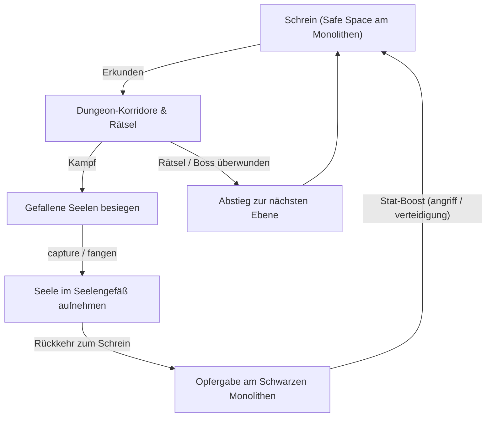

# Konzept & Plan: Soul Collector — Der Schwarze Monolith

**Genre:** Dark Fantasy Dungeon Crawler / Soulslike Rogue-Lite  
**Arbeitstitel:** *Soul Collector — Echoes of the Monolith*  
**Ziel-Features:**
- **`OPEN-19` Multi-Raum-Objekte (`locations: [...]`):**
  - **Der Schwarze Monolith** (`schwarzer_monolith`): Ein kolossales, uraltes Obsidian-Bauwerk, das vertikal durch den gesamten Dungeon ragt und auf jeder Etage im zentralen Schrein sichtbar, anfassbar und ansprechbar ist (`locations: [ebene1_schrein, ebene2_schrein, ebene3_schrein]`).
  - Der Schreinraum jeder Etage fungiert als absolute Schutzzone (**Safe Space**): Keine Aggro, Regeneration von Gesundheit (`rasten`), Speichern und Darbringen von Seelen.
- **`OPEN-18` Zufallsauswahl im `messages:`-Katalog (`PICK-ONE`):**
  - Atmosphärische Flüsterstimmen und Visionen des Monolithen bei Interaktionen (`touch monolith`, `sacrifice soul`).
  - Dynamische, unheimliche Ablehnungs- und Kampfreaktionen ("Die Klinge gleitet wirkungslos durch den Äther...", "Ein eisiges Heulen zerreißt deine Gedanken...", etc.).
- **Seelenfänger-Mechanik (Soul Collection Loop):**
  - Besiegte Gegner hinterlassen ihre körperlosen Echos: `capture <seele>` / `fangen` überträgt die gefallene Seele in das Seelengefäß (`seelengefaess`) des Spielers.
  - Opfergabe am Monolithen: `opfern <seele>` / `darbringen`:
    - **Schattenseele** (Ebene 1): Erhöht permanent die Angriffskraft (`angriff + 2`).
    - **Eisen-Ghul-Seele** (Ebene 2): Erhöht permanent die Rüstung/Abwehr (`verteidigung + 2`).
    - **Erz-Dämonen-Seele** (Ebene 3 Boss): Schaltet die finale Transzendenz frei.
- **Tiefen-Skalierung & Minimalumsetzung:**
  - Konzentriertes 3-Ebenen-Design:
    - **Ebene 1 (Verfallene Katakomben):** Einführung, schwächere Schattenkriecher, Hebelrätsel für die Kryptapforte.
    - **Ebene 2 (Kerkertiefen):** Schwerere Eisen-Ghouls, Runenrätsel der Versiegelung.
    - **Ebene 3 (Abgrund / Der Weltenkern):** Bossgegner (Der Seelenfresser) vor dem Fuß des Monolithen.

---

## 1. Kern-Loop & Spielablauf



1. **Rast & Vorbereitung:**
   - Im Schrein ruht der Spieler am Sockel des Monolithen. Lebenspunkte regenerieren.
2. **Vorstoß in die Tiefen:**
   - Jede Ebene bietet verzweigte Kammern mit Gefahren, Rätseln (z. B. Runenschalter, Seelenwaage) und Feinden.
3. **Kampf & Seelenfang:**
   - Nach dem Sieg manifestiert sich eine ungebundene Essenz.
   - Mit dem Befehl `capture seele` fängt der Spieler sie ein.
4. **Aufstieg der Attribute:**
   - Am Monolithen führt `opfern <seele>` zu einer dauerhaften Stärkung.
   - Da der Monolith auf **allen** Ebenen physisch präsent ist (via `OPEN-19`), muss der Spieler nicht mühsam nach ganz oben zurücklaufen, sondern kann den Schrein der aktuellen Ebene nutzen!

---

## 2. Raumtopologie (Minimalumsetzung: 3 Ebenen)

```
[Ebene 1 - Katakomben]
[ebene1_kammer] --- [ebene1_schrein] (Monolith) --- [ebene1_tor] (Hebelrätsel)
                           | Treppe abwärts
[Ebene 2 - Kerker]
[ebene2_verlies] --- [ebene2_schrein] (Monolith) --- [ebene2_siegel] (Runenrätsel)
                           | Abgrund-Stiege
[Ebene 3 - Weltenkern]
[ebene3_abgrund] --- [ebene3_schrein] (Monolith Fuß) --- [ebene3_thron] (Boss: Seelenfresser)
```

- **`ebene1_schrein`**, **`ebene2_schrein`**, **`ebene3_schrein`**:
  - Alle drei Räume enthalten das identische `OPEN-19`-Objekt `schwarzer_monolith` (`locations: [ebene1_schrein, ebene2_schrein, ebene3_schrein]`).
  - Eine Interaktion auf Ebene 2 (z. B. `touch monolith` oder `examine monolith`) bezieht sich auf dieselbe Entität wie auf Ebene 1 oder 3, reagiert aber ggf. auf den Tiefenstatus oder die gesammelten Gesamtopfer.

---

## 3. Geplante Engine-Voraussetzungen

### A. OPEN-19: Multi-Raum-Objekte (`locations: [...]`)
- Definition im Item:
  ```yaml
  items:
    - id: schwarzer_monolith
      name: Schwarzer Monolith
      locations:
        - ebene1_schrein
        - ebene2_schrein
        - ebene3_schrein
      portable: false
      gender: m
      article: { nom: "der", acc: "den", dat: "dem" }
      desc: >
        Eine monolithische Säule aus spiegelglattem, tiefschwarzem Obsidian.
        Sie pulsiert mit einer finsteren Resonanz und reicht senkrecht durch
        den gesamten Berg hinab in den Abgrund.
  ```
- **Engine-Bedarf:** Der Parser und die Sichtbarkeitsprüfung müssen Items mit `locations: [...]` in allen aufgelisteten Räumen finden und anvisieren können.

### B. OPEN-18: Zufallsauswahl im `messages:`-Katalog (`PICK-ONE`)
- Ermöglicht abwechslungsreiche Whispers und Reaktionen:
  ```yaml
  messages:
    monolith.whisper:
      - "Eine Grabesstimme flüstert in deinem Geist: 'Bringe mir die Essenz der Gefallenen...'"
      - "Kalter Hauch weht von der Obsidianfläche. Schemenhafte Gesichter verziehen sich zu stummen Schreien."
      - "Der Monolith summt tief. Du spürst das Verlangen uralter Götter nach Seelen."
  ```

---

## 4. Attribute & Progressionsmechanik

- **Variablen:**
  - `spieler_hp` (Start 30, Max 30)
  - `spieler_angriff` (Start 5)
  - `spieler_abwehr` (Start 2)
  - `seelen_geopfert` (Zähler für Monolithen-Progress)
- **Aktionen:**
  - `capture <seele>` (Alias: `fangen`, `einfangen`, `binden`):
    - Prüft, ob eine besiegte Seele im Raum präsent ist (`location: here`).
    - Nimmt die Seele ins Inventar auf.
  - `opfern <seele>` (Alias: `sacrifice`, `darbringen`):
    - Prüft `at: player, room: {ebeneX_schrein}` (also Anwesenheit des Monolithen).
    - Verbraucht die Seele (`consume`).
    - Erhöht die Attribute (`spieler_angriff`, `spieler_abwehr`).
    - Feuert Zufallsvision des Monolithen (`OPEN-18`).
  - `rasten` (Alias: `rest`, `ausruhen`):
    - Nur im Schrein möglich: Heilt den Spieler auf volle `spieler_hp`.

---

## 5. Nächste Schritte zur Umsetzung

1. **Aktuell im Fokus:** Fertigstellung des aktuellen Meilensteins (**Survival Wilderness Mystery** `examples/genres/survival_expedition.yaml` mit `OPEN-17`).
2. **Nächste Engine-Tickets:**
   - `OPEN-18` (Zufallsauswahl in Meldungen / Listenunterstützung).
   - `OPEN-19` (Multi-Raum-Objekte `locations: [...]`).
3. **Danach:** Direkte Realisierung von *Soul Collector* als Benchmark und Showcase für `OPEN-18` und `OPEN-19`!
